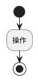

# mc-addons-help

[mc-addons](../mc-addons)（Minecraft 統合版アドオン群）のヘルプサイトです。
[Astro](https://astro.build/) + [Starlight](https://starlight.astro.build/) で構築しています。

## 前提

- Node.js 22 以降
- Kroki サーバー（図表のレンダリングに使用。既定は `http://localhost:8000`）

```sh
docker run -d --name kroki -p 8000:8000 yuzutech/kroki
```

別のサーバーを使う場合は、環境変数 `KROKI_SERVER` で指定します。

## コマンド

| コマンド | 内容 |
| --- | --- |
| `npm install` | 依存パッケージをインストール |
| `npm run dev` | 開発サーバーを起動（http://localhost:4321/mc-addons-help/） |
| `npm run build` | `dist/` に静的サイトを生成 |
| `npm run preview` | ビルド結果をプレビュー |

## 公開

GitHub Pages で https://takevox.github.io/mc-addons-help/ に公開しています。
公開元は `publish` ブランチのルートで、中身は `dist/` のビルド結果だけです（ソースは `main`）。

```sh
npm run build
git worktree add ../mc-addons-help-publish publish
cp -r dist/. ../mc-addons-help-publish/
cd ../mc-addons-help-publish
git add -A && git commit -m "サイトを更新" && git push origin publish
cd - && git worktree remove ../mc-addons-help-publish
```

- `publish` には `.nojekyll` を置いています（`_astro/` フォルダを配信するため）。消さないでください。
- サイトは `/mc-addons-help/` 配下に置かれます。本文のリンクは `/bookmark/` のようにルートから書けば、ビルド時に自動で `/mc-addons-help` が付きます。

## ページの追加

本文は `src/content/docs/` 以下の Markdown です。

```text
src/content/docs/
├── index.md              トップページ
├── getting-started/      はじめに（概要・診断など共通事項）
├── bookmark/             ブックマーク
├── eeps/                 拡張経験値システム
├── sortstick/            ソートスティック
└── enhancedrecipes/      Enhanced Recipes
```

- サイドバーはフォルダごとに自動生成されます。並び順は frontmatter の `sidebar.order` で指定します。
- 新しいアドオンを追加するときは、フォルダを作り、`astro.config.mjs` の `sidebar` にグループを追加します。

## 図表

コードブロックの言語を `plantuml` または `graphviz` にすると、ビルド時に Kroki で SVG に変換されて埋め込まれます。

````md

````

その他の Kroki 対応形式は ```` ```kroki type=<形式> ```` で書けます。

> [!NOTE]
> Mermaid は Kroki 本体とは別のコンテナ（`yuzutech/kroki-mermaid`）が必要です。現在の構成では使えません。

Kroki に接続できないときもビルドは失敗せず、図の位置にエラー画像が入ります。
