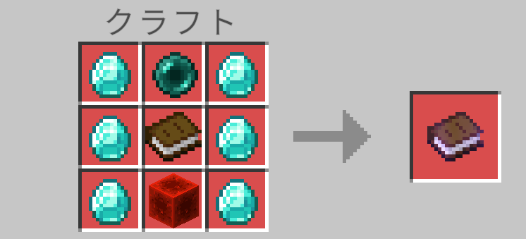
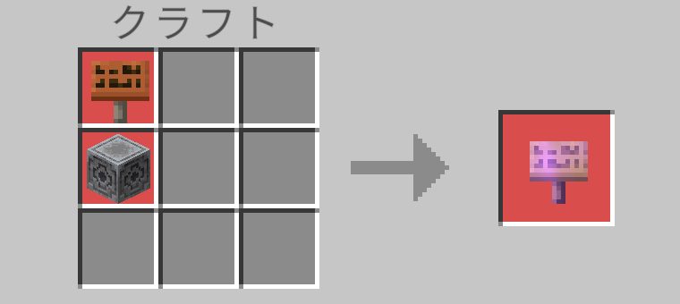

どちらのアイテムも **作業台** でクラフトします。

## ブックマーク

| | | |
| --- | --- | --- |
| ダイヤモンド | エンダーパール | ダイヤモンド |
| ダイヤモンド | 本 | ダイヤモンド |
| ダイヤモンド | レッドストーンブロック | ダイヤモンド |

- 材料: ダイヤモンド ×6、エンダーパール ×1、本 ×1、レッドストーンブロック ×1
- できあがり: ブックマーク ×1
- レシピ本への表示: エンダーパールかレッドストーンブロックを手に入れると表示されます。

## 転送板

| |
| --- |
| 看板（どの木材でも可） |
| ロードストーン |

- 材料: 看板 ×1、ロードストーン ×1（看板を上、ロードストーンを下に縦に並べる）
- できあがり: 転送板 ×1
- レシピ本への表示: ロードストーンを手に入れると表示されます。

使える看板は次の 12 種類です。

オーク、トウヒ、シラカバ、ジャングル、アカシア、ダークオーク、マングローブ、サクラ、ペールオーク、竹、真紅、歪んだ

:::note
転送板のレシピにはブックマークは不要です。ブックマークはあとから転送板に埋め込みます。
:::
