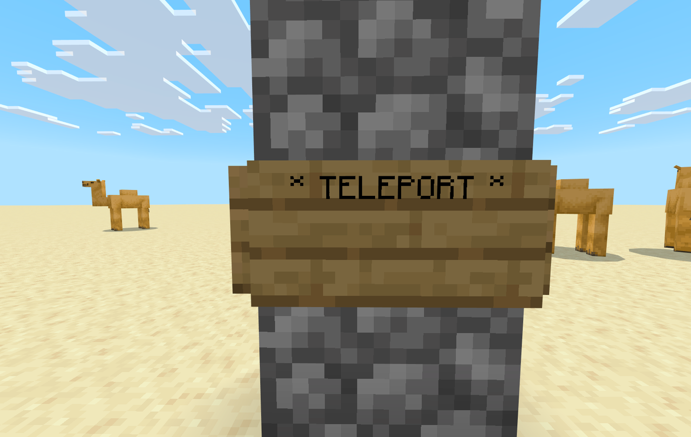
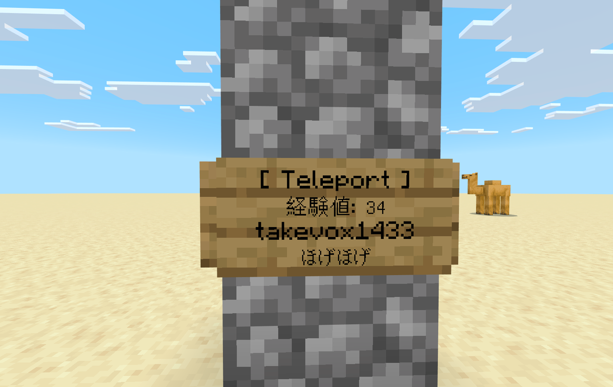

転送板は、ブックマークを埋め込んで設置できるテレポート地点です。
見た目は看板で、右クリックするだけで、埋め込んだブックマークを使ったときと同じようにテレポートできます。
ブックマークを持っていないプレイヤーも使えるので、拠点の入口などに置いておくと便利です。

## 設置する

転送板を手に持ち、ブロックに向けて **使い** ます。

| 向けた面 | 置かれる看板 |
| --- | --- |
| ブロックの上面 | 立て看板（自分の向きに合わせて回転） |
| ブロックの側面 | 壁掛け看板 |

置いた直後の看板には `* TELEPORT *` と表示されます。



看板は文字を編集できない状態（蜜蝋がけ）で置かれます。

:::note
置こうとした場所がふさがっていると「ここには設置できません。」と表示されます。下面には設置できません。
:::

## ブックマークを埋め込む

[座標を記録した](/bookmark/recording/) ブックマークを手に持ち、設置した転送板を **殴り** ます。

- 埋め込んだブックマークは手元から消えます（転送板を壊すと戻ってきます）。
- 1 枚の転送板に埋め込めるブックマークは 1 冊だけです。あとから差し替えることはできません。

埋め込むと、看板の文字が次のように変わります。

```text
[ Teleport ]
経験値: 87
Steve
ブックマーク
```



| 行 | 内容 |
| --- | --- |
| 1 行目 | `[ Teleport ]`（埋め込み済みの印） |
| 2 行目 | 転送板の位置から記録座標までの消費経験値（目安） |
| 3 行目 | ブックマークに座標を記録したプレイヤー |
| 4 行目 | ブックマークの名前（金床で付けた名前があればその名前） |

## テレポートする

埋め込み済みの転送板を **使い**（右クリック）ます。何も持っていなくても使えます。

テレポートの条件と費用は [ブックマークを使ったとき](/bookmark/teleport/) と同じです。

- 費用は **使った人がいる場所** からの距離で計算されます。看板 2 行目の値は、転送板の位置から計算した目安です。
- 費用は使った人の経験値から払います。

## 回収する

転送板を **壊す** と回収できます。

- 転送板のアイテムが 1 個ドロップします（クリエイティブモードではドロップしません）。
- ブックマークを埋め込んでいた場合は、ブックマークも別にドロップします。記録した座標・記録者・名前はそのまま残っています。

:::caution
ブックマークを手に持っている間は、転送板を壊せません。別のアイテムに持ち替えるか、素手で壊してください。
:::

## うまくいかないとき

| メッセージ | 原因 | 対処 |
| --- | --- | --- |
| ここには設置できません。 | 置く場所がふさがっている、または下面に向けた | 空いている場所の上面か側面に向けて使う |
| 座標が記録されていないブックマークは埋め込めません。 | 未記録のブックマークで殴った | 先に [座標を記録する](/bookmark/recording/) |
| この転送板には既にブックマークが埋め込まれています。 | 埋め込み済み | 差し替えるときは一度壊して置き直す |
| この転送板にはブックマークが埋め込まれていません。 | 空の転送板を使った | ブックマークを埋め込む |
