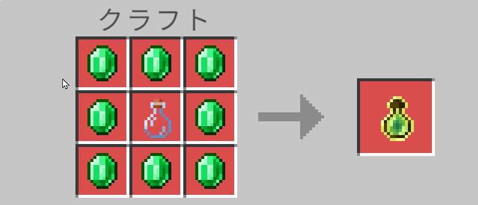
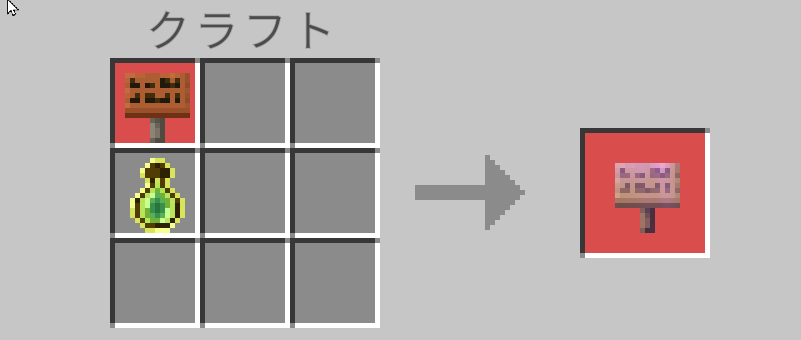
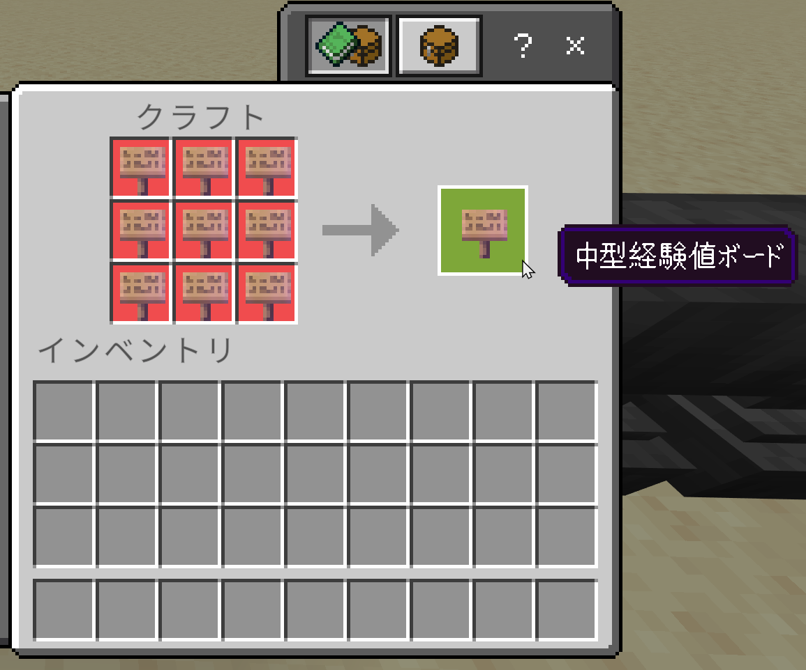
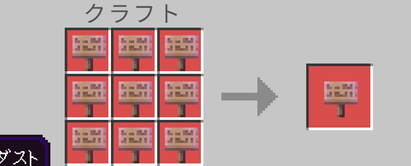

すべて **作業台** でクラフトします。

## 空の経験値ボトル

| | | |
| --- | --- | --- |
| エメラルド | エメラルド | エメラルド |
| エメラルド | ガラス瓶 | エメラルド |
| エメラルド | エメラルド | エメラルド |

- 材料: エメラルド ×8、ガラス瓶 ×1
- できあがり: 空の経験値ボトル ×1
- レシピ本への表示: エメラルドを手に入れると表示されます。

:::note
封入済み経験値ボトルはクラフトできません。空の経験値ボトルに経験値を詰めると作れます。
:::

## 経験値ボード

| |
| --- |
| 看板（どの木材でも可） |
| 空の経験値ボトル |

- 材料: 看板 ×1、空の経験値ボトル ×1（看板を上、ボトルを下に縦に並べる）
- できあがり: 経験値ボード ×1
- レシピ本への表示: 空の経験値ボトルを手に入れると表示されます。

使える看板は、オーク、トウヒ、シラカバ、ジャングル、アカシア、ダークオーク、マングローブ、サクラ、ペールオーク、竹、真紅、歪んだ の 12 種類です。

## 中型経験値ボード

経験値ボード ×9 を、作業台の 3×3 すべてに並べます。

- できあがり: 中型経験値ボード ×1
- レシピ本への表示: 経験値ボードを手に入れると表示されます。

## 大型経験値ボード

中型経験値ボード ×9 を、作業台の 3×3 すべてに並べます。

- できあがり: 大型経験値ボード ×1
- レシピ本への表示: 中型経験値ボードを手に入れると表示されます。

:::tip
大型経験値ボード 1 枚には、経験値ボード 81 枚（空の経験値ボトル 81 本、エメラルド 648 個）が必要です。
:::
