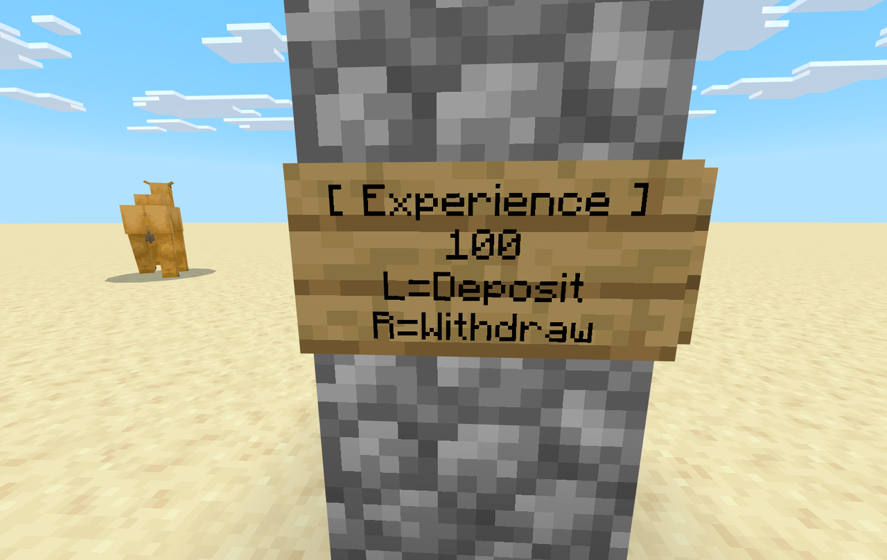
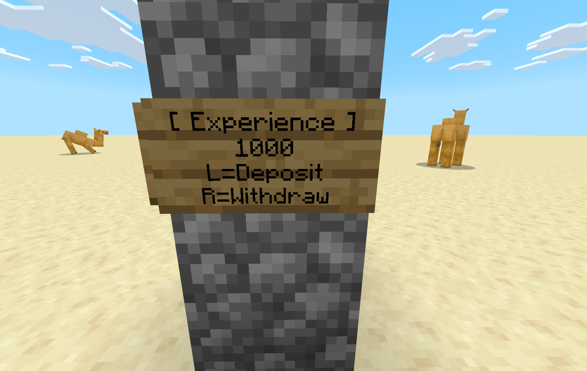

経験値ボードは、経験値を預けておける看板です。
預けた経験値は **プレイヤーごとの残高** として記録され、ワールド内の **どのボードからでも** 同じ残高を出し入れできます。

## ボードの種類

| ボード | 1 回の操作で動くポイント |
| --- | --- |
| 経験値ボード | 100 |
| 中型経験値ボード | 1,000 |
| 大型経験値ボード | 10,000 |

## 設置する

ボードを手に持ち、ブロックに向けて **使い** ます。

| 向けた面 | 置かれる看板 |
| --- | --- |
| ブロックの上面 | 立て看板（自分の向きに合わせて回転） |
| ブロックの側面 | 壁掛け看板 |

看板には次のように表示されます（2 行目は 1 回の操作で動くポイント）。

```text
[ Experience ]
100
L=Deposit
R=Withdraw
```





看板は文字を編集できない状態（蜜蝋がけ）で置かれます。

## 預け入れ・引き出し

| 操作 | 動作 |
| --- | --- |
| ボードを **殴る**（左クリック） | 自分の経験値から、ボードの単位ポイントを残高に **預ける**。足りないときは持っている分を全部預ける |
| ボードを **使う**（右クリック） | 残高から、ボードの単位ポイントを **引き出す**。残高が単位より少ないときは残高を全部引き出す |

操作のたびに、チャットに残高が表示されます。

```text
経験値 100 ポイントを預けました。残高 1250 ポイント
```

## 残高について

- 残高は **プレイヤー本人だけ** のものです。他のプレイヤーが同じボードを使っても、その人の残高が使われます。
- 残高はワールドに保存されます。ワールドを出入りしても消えません。
- ボードの大きさが違っても、残高は共通です。小さいボードで預けて、大きいボードで引き出すこともできます。

## 回収する

**スニークしながら壊す** と回収できます。

- 置いたときと同じ大きさのボードが 1 枚ドロップします（クリエイティブモードではドロップしません）。
- ボードを回収しても、残高は減りません。

:::caution
スニークせずに壊そうとしても、ボードは壊れません。
「経験値ボードを回収するにはスニークしながら壊してください。」と表示されます。
:::

## うまくいかないとき

| メッセージ | 原因 | 対処 |
| --- | --- | --- |
| ここには設置できません。 | 置く場所がふさがっている、または下面に向けた | 空いている場所の上面か側面に向けて使う |
| 預ける経験値がありません。残高 N ポイント | 自分の経験値が 0 | 経験値をためてから預ける |
| 預けている経験値がありません。 | 残高が 0 | 先に預ける |
| 経験値が上限のため引き出せません。残高 N ポイント | 自分の経験値がこれ以上増やせない | 経験値を使ってから引き出す |
| 経験値ボードを回収するにはスニークしながら壊してください。 | スニークせずに壊そうとした | スニークしながら壊す |
