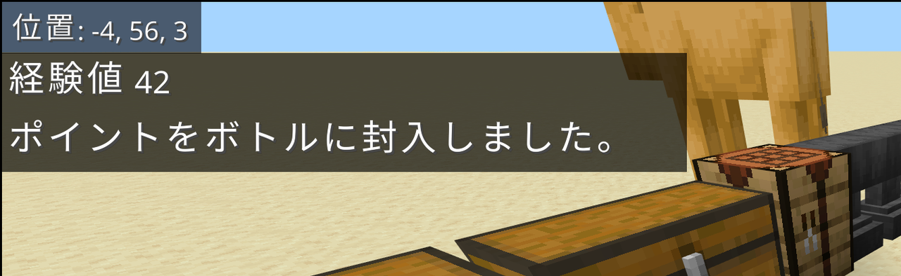
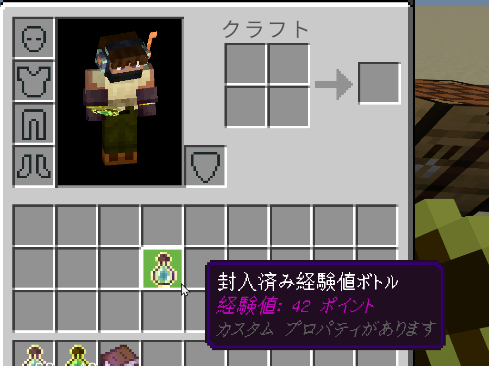

## 経験値を詰める

**空の経験値ボトル** を手に持って **使い**（右クリック）ます。

- 自分の経験値から、最大 **1,000 ポイント** をボトルに詰めます。1,000 ポイント未満しか無いときは、全部詰めます。
- ボトルは **封入済み経験値ボトル** に変わり、説明文に中身のポイントが表示されます。

```text
経験値: 1000 ポイント
```





空のボトルを重ねて持っているときは 1 本だけ使われ、封入済みボトルはインベントリの空いている場所に入ります。
インベントリがいっぱいのときは、足元に落ちます。

## 経験値を取り出す

**封入済み経験値ボトル** を手に持って **使い** ます。

- 中身のポイントがすべて自分の経験値に戻り、ボトルは **空の経験値ボトル** に戻ります。
- 経験値が上限に達して入りきらなかった分は、ボトルに残ります。

## うまくいかないとき

| メッセージ | 原因 | 対処 |
| --- | --- | --- |
| 封入できる経験値がありません。 | 経験値が 0 | 経験値をためてから使う |
| 経験値が上限のため取り出せません。 | 自分の経験値がこれ以上増やせない | 経験値を使ってから取り出す |
| 経験値が上限のため N ポイントだけ取り出しました。ボトルの残り M ポイント | 一部だけ取り出せた | 残りはボトルに入ったままなので、あとでまた使える |

:::tip
封入済み経験値ボトルは他のプレイヤーに渡せます。受け取った人が使えば、その人の経験値になります。
:::

:::note
封入済み経験値ボトルは、クリエイティブモードのアイテム一覧には表示されません。
:::
